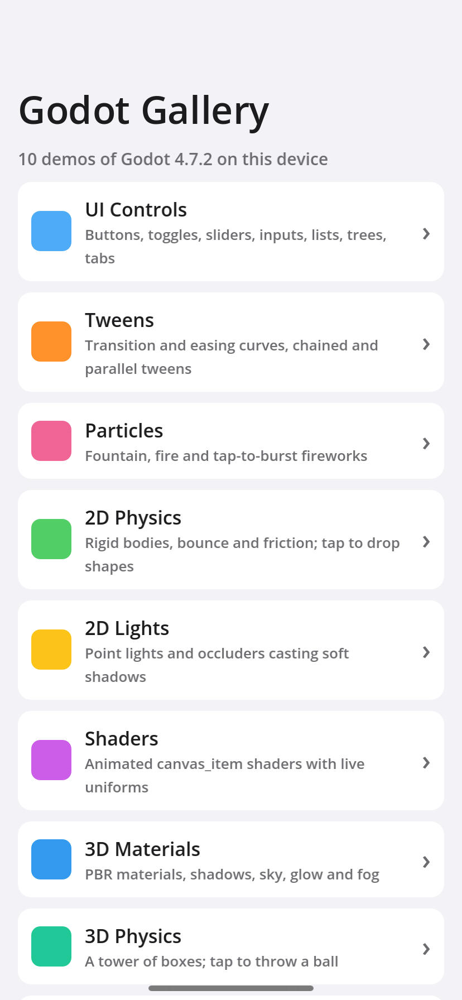
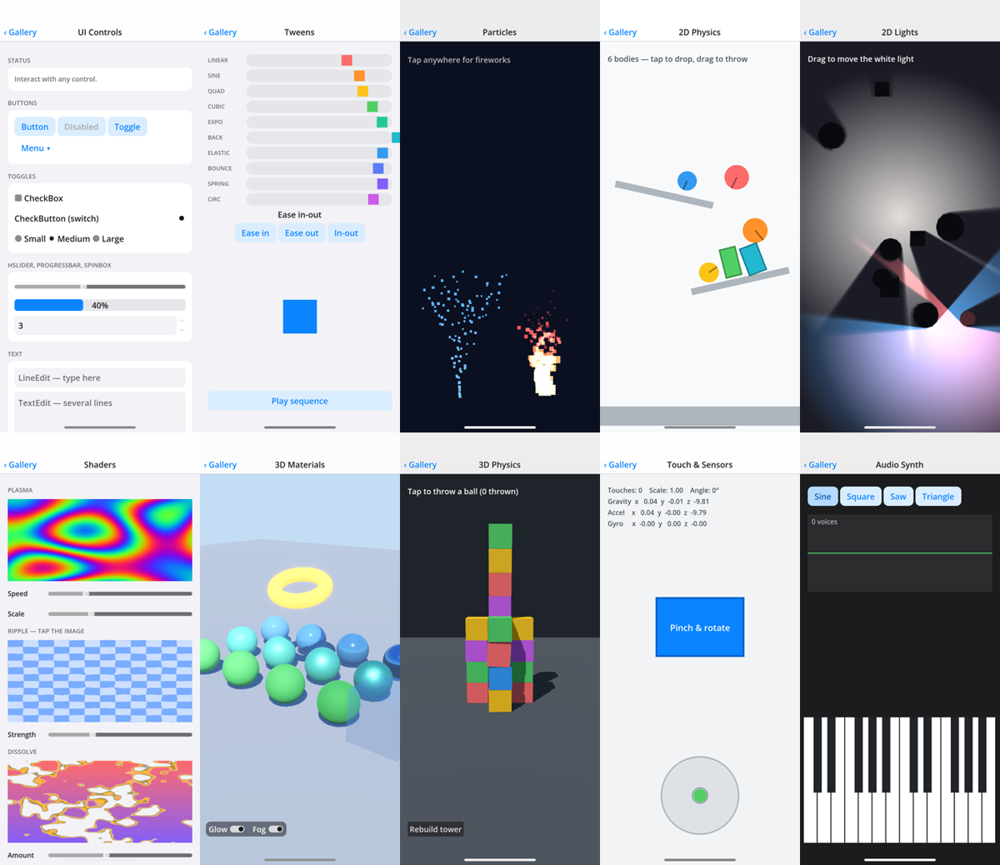

<div align="center">

# Godot Gallery

**English** · [简体中文](README_zh.md)

10 Godot 4 demos in one mobile app: UI controls, tweens, particles, 2D and 3D physics, 2D lights and shadows, shaders, PBR materials, multi-touch and motion sensors, and a synthesizer.<br/>
Everything is plain GDScript that builds its own nodes, so each demo is one readable file.<br/>
Exports to an iOS project that builds and runs on iPhone from Windows, Linux or macOS with [KXBuild](https://github.com/kxbuild/kxbuild).



</div>

## What's inside

| Demo | Shows |
|---|---|
| **UI Controls** | `Button`, `MenuButton`, `CheckBox`, `CheckButton`, radio groups, `HSlider`, `ProgressBar`, `SpinBox`, `LineEdit`, `TextEdit`, `RichTextLabel` with BBCode effects, `OptionButton`, `ColorPickerButton`, `ItemList`, `Tree`, `TabContainer` |
| **Tweens** | Ten transition curves with ease in / out / in-out, a chained and parallel tween sequence |
| **Particles** | `CPUParticles2D` fountain and additive flame, tap-to-burst fireworks |
| **2D Physics** | `RigidBody2D` balls and boxes with bounce and friction, angled shelves; tap to drop, drag to throw |
| **2D Lights** | `PointLight2D` with soft `LightOccluder2D` shadows under a `CanvasModulate`; drag the main light |
| **Shaders** | Three `canvas_item` shaders (plasma, ripple, dissolve) with uniforms on sliders |
| **3D Materials** | Metallic / roughness sphere grid, emissive torus, glass, directional shadows, procedural sky, glow and fog; drag to orbit, pinch to zoom |
| **3D Physics** | A tower of `RigidBody3D` boxes; tap to throw a heavy ball |
| **Touch & Sensors** | Multi-touch points, a pinch / rotate card, a bubble level from gravity, accelerometer and gyroscope readouts |
| **Audio Synth** | A two-octave multi-touch keyboard generating sine / square / saw / triangle waves with `AudioStreamGenerator`, plus an oscilloscope |

The project uses the Mobile renderer and Godot 4.7.



## Run it on an iPhone

You need the Godot 4.7 editor with its export templates installed, KXBuild ([install guide](https://github.com/kxbuild/kxbuild#-install)) and [signing](https://github.com/kxbuild/kxbuild#-signing) set up.

```shell
git clone https://github.com/kxbuild/godot-gallery.git
cd godot-gallery

# Export the iOS project into export/ (or use Project > Export > iOS in the editor)
godot --headless --path . --import
godot --headless --path . --export-debug iOS export/GodotGallery.ipa

# Build, install on the USB-connected iPhone and launch it
kxbuild run export/GodotGallery.xcodeproj
```

`godot` stands for the Godot editor executable (on Windows, the `_console.exe` build). Export again after changing scripts; the export only writes the Xcode project, KXBuild compiles and signs it.

The preset's App Store Team ID is a placeholder (`ABCDE12345`): KXBuild signs with the team of the provisioning profile it finds. The bundle identifier is `com.kxbuild.godotgallery`; to use your own, change `application/bundle_identifier` in `export_presets.cfg` and export again.

To open one demo right away, pass its id as a launch argument, for example `--args "-demo scene3d"`. The ids are in [main.gd](main.gd).

## Run it on the desktop

Open the folder in the Godot editor and press F5. Mouse clicks act as touches. `--demo=<id>` after `--` on the command line opens a demo directly.

## Project layout

```
project.godot        Mobile renderer, portrait 414×896 base size
main.tscn / main.gd  the menu, navigation bar and demo host
demos/*.gd           one file per demo; each builds its nodes in _ready()
export_presets.cfg   the iOS export preset
```

To add a demo, write a script in `demos/` that extends `Control`, `Node2D` or `Node3D`, and add an entry to `DEMOS` in `main.gd`.

## Related repositories

- [**KXBuild**](https://github.com/kxbuild/kxbuild): build, run and publish iOS apps from Windows, Linux or macOS, on the command line or in VS Code
- [SwiftUI Gallery](https://github.com/kxbuild/swift-gallery): 15 SwiftUI demos: controls, lists, animation, gestures, Swift Charts, MapKit, SwiftData
- [UIKit Gallery (Objective-C)](https://github.com/kxbuild/objc-gallery): 14 UIKit demos in Objective-C, every view built in code
- [Flutter Gallery](https://github.com/kxbuild/flutter-gallery): Material and Cupertino widgets plus four complete sample apps
- [React Native Gallery](https://github.com/kxbuild/react-native-gallery): 16 demos of React Native's built-in components and APIs
- [Expo Gallery](https://github.com/kxbuild/expo-gallery): 22 Expo SDK modules: camera, sensors, location, SQLite and more
- [Unity Gallery](https://github.com/kxbuild/unity-gallery): 10 Unity 6 demos exported to iOS
- [KXBuild App Templates](https://github.com/kxbuild/kxbuild-app-templates): Project and target templates for `kxbuild project create` and `add-target`

## License

Apache 2.0. See [LICENSE](LICENSE). Godot is a trademark of the Godot Foundation.
