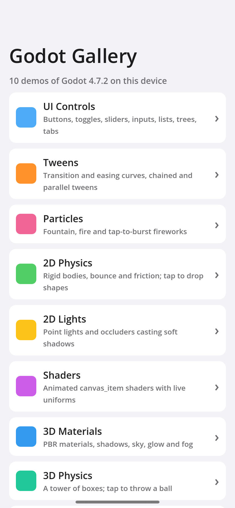
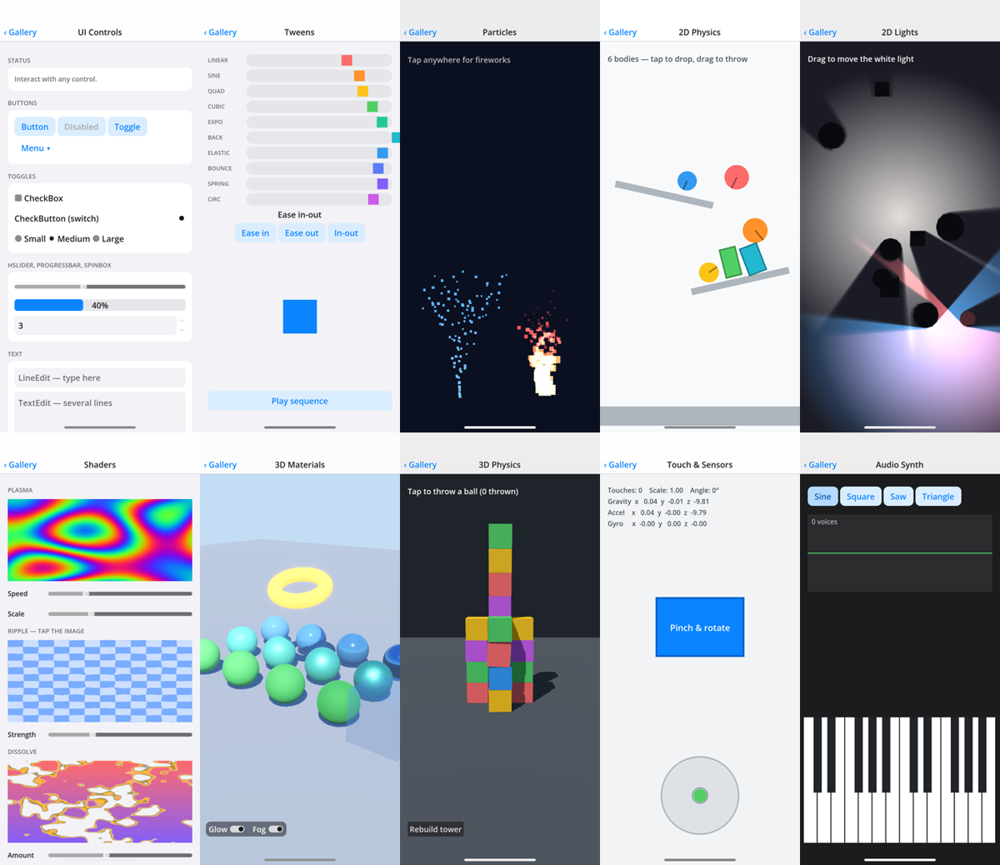

<div align="center">

# Godot Gallery

[English](README.md) · **简体中文**

一个移动应用里集中展示 10 个 Godot 4 示例：UI 控件、补间动画、粒子、2D 与 3D 物理、2D 光照与阴影、着色器、PBR 材质、多点触控与运动传感器，以及一个合成器。<br/>
全部是用 GDScript 在代码里创建节点，每个示例就是一个易读的文件。<br/>
导出为 iOS 工程后，在 Windows、Linux、macOS 上用 [KXBuild](https://github.com/kxbuild/kxbuild) 即可编译并安装到 iPhone 上运行。



</div>

## 包含内容

| 示例 | 展示内容 |
|---|---|
| **UI Controls** | `Button`、`MenuButton`、`CheckBox`、`CheckButton`、单选组、`HSlider`、`ProgressBar`、`SpinBox`、`LineEdit`、`TextEdit`、带 BBCode 特效的 `RichTextLabel`、`OptionButton`、`ColorPickerButton`、`ItemList`、`Tree`、`TabContainer` |
| **Tweens** | 十种过渡曲线配合缓入 / 缓出 / 缓入缓出，链式与并行补间序列 |
| **Particles** | `CPUParticles2D` 喷泉和叠加混合的火焰，点击绽放烟花 |
| **2D Physics** | 带弹性和摩擦的 `RigidBody2D` 小球与方块、倾斜挡板；点击投放，拖动抛出 |
| **2D Lights** | `CanvasModulate` 下的 `PointLight2D` 与 `LightOccluder2D` 柔和阴影；拖动主光源 |
| **Shaders** | 三个 `canvas_item` 着色器（等离子、涟漪、溶解），用滑块调节 uniform |
| **3D Materials** | 金属度 / 粗糙度球体阵列、自发光圆环、玻璃、平行光阴影、程序化天空、辉光与雾；拖动环绕视角，双指缩放 |
| **3D Physics** | `RigidBody3D` 方块搭成的塔；点击扔出重球 |
| **Touch & Sensors** | 多点触控、可双指缩放旋转的卡片、基于重力的水平仪、加速度计与陀螺仪读数 |
| **Audio Synth** | 两个八度的多点触控键盘，用 `AudioStreamGenerator` 实时生成正弦 / 方波 / 锯齿波 / 三角波，并显示示波器 |

项目使用 Mobile 渲染器和 Godot 4.7。



## 在 iPhone 上运行

准备：已安装 Godot 4.7 编辑器及其导出模板、KXBuild（[安装说明](https://github.com/kxbuild/kxbuild/blob/main/README_zh.md)），并配置好[签名](https://github.com/kxbuild/kxbuild/blob/main/README_zh.md)。

```shell
git clone https://github.com/kxbuild/godot-gallery.git
cd godot-gallery

# 把 iOS 工程导出到 export/（也可以在编辑器里用 项目 > 导出 > iOS）
godot --headless --path . --import
godot --headless --path . --export-debug iOS export/GodotGallery.ipa

# 编译，安装到 USB 连接的 iPhone 并启动
kxbuild run export/GodotGallery.xcodeproj
```

`godot` 指 Godot 编辑器可执行文件（Windows 上用 `_console.exe` 版本）。修改脚本后重新导出；导出只生成 Xcode 工程，由 KXBuild 负责编译和签名。

导出预设里的 App Store Team ID 是占位值（`ABCDE12345`），KXBuild 会用找到的描述文件所属团队签名。Bundle ID 是 `com.kxbuild.godotgallery`；要换成你自己的，修改 `export_presets.cfg` 里的 `application/bundle_identifier` 后重新导出。

想启动后直接打开某个示例，把它的 id 作为启动参数传入，例如 `--args "-demo scene3d"`。全部 id 见 [main.gd](main.gd)。

## 在电脑上运行

用 Godot 编辑器打开本目录后按 F5，鼠标点击等同于触摸。命令行在 `--` 之后加 `--demo=<id>` 可直接打开某个示例。

## 目录结构

```
project.godot        Mobile 渲染器，竖屏 414×896 基准尺寸
main.tscn / main.gd  菜单、导航栏和示例容器
demos/*.gd           每个示例一个文件，在 _ready() 里创建节点
export_presets.cfg   iOS 导出预设
```

新增示例：在 `demos/` 里写一个继承 `Control`、`Node2D` 或 `Node3D` 的脚本，再到 `main.gd` 的 `DEMOS` 里加一项。

## 相关仓库

- [**KXBuild**](https://github.com/kxbuild/kxbuild)：在 Windows、Linux、macOS 上编译、运行、发布 iOS App 的命令行工具和 VS Code 插件
- [SwiftUI Gallery](https://github.com/kxbuild/swift-gallery)：15 个 SwiftUI 示例：控件、列表、动画、手势、Swift Charts、MapKit、SwiftData
- [UIKit Gallery（Objective-C）](https://github.com/kxbuild/objc-gallery)：14 个 Objective-C 编写的 UIKit 示例，所有视图都在代码里创建
- [Flutter Gallery](https://github.com/kxbuild/flutter-gallery)：Material 与 Cupertino 组件，外加四个完整示例应用
- [React Native Gallery](https://github.com/kxbuild/react-native-gallery)：16 个 React Native 内置组件与 API 示例
- [Expo Gallery](https://github.com/kxbuild/expo-gallery)：22 个 Expo SDK 模块：相机、传感器、定位、SQLite 等
- [Unity Gallery](https://github.com/kxbuild/unity-gallery)：10 个 Unity 6 示例，导出为 iOS 工程
- [KXBuild 应用模板](https://github.com/kxbuild/kxbuild-app-templates)：`kxbuild project create` 和 `add-target` 使用的项目与 target 模板，欢迎贡献

## 许可证

Apache 2.0，见 [LICENSE](LICENSE)。Godot 是 Godot Foundation 的商标。
